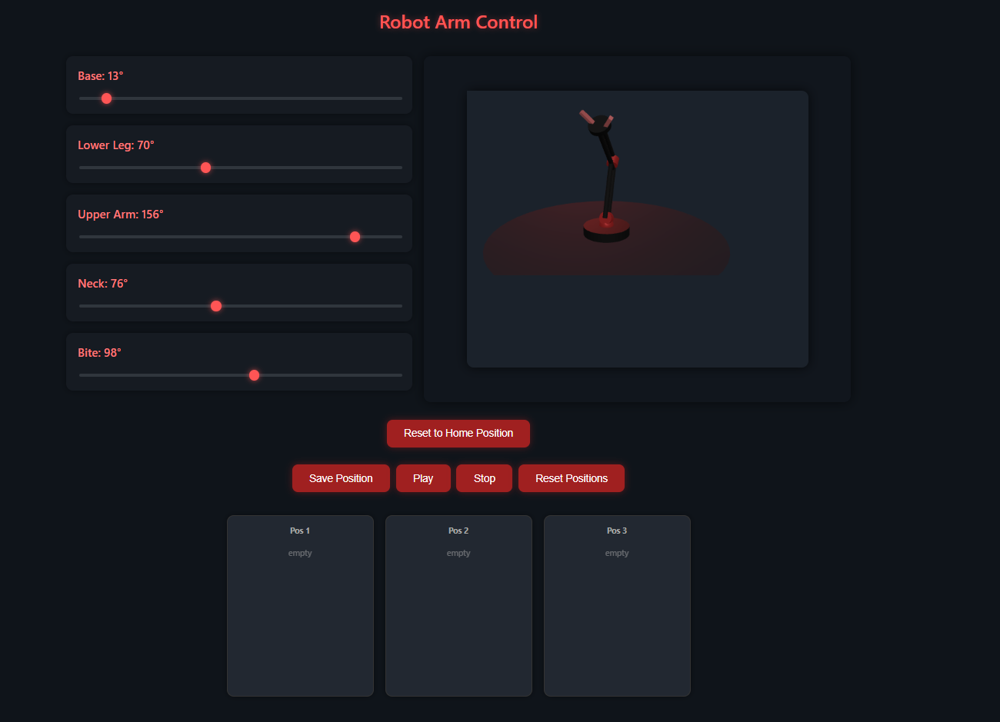

# RoboticsAdeept

Web-based remote control for the **Adeept ADA031 robotic arm kit**.

A **Flask** web server on a **Raspberry Pi 4** serves a browser control panel and forwards
servo commands over **USB serial** to the **Adeept Arm Drive Board** (ATmega328P, Arduino Uno
compatible). The board drives the five servos and shows `REMOTE CONTROL` on its OLED screen.



```
 Browser (PC / phone)               Raspberry Pi 4                     Adeept Arm Drive Board
┌──────────────────┐  HTTP :5000  ┌────────────────────┐  USB serial  ┌───────────────────────┐
│ index.html       │ ───────────► │ server/server.py   │ ───────────► │ block_py/block_py.ino │
│ sliders, 3D view │ ◄─────────── │ Flask + watchdog   │  115200 baud │ 5 servos + OLED       │
└──────────────────┘     JSON     └────────────────────┘              └───────────────────────┘
```

## Contents

1. [Repository layout](#1-repository-layout)
2. [Hardware](#2-hardware)
3. [How it works (theory)](#3-how-it-works-theory)
4. [Install the tools](#4-install-the-tools)
5. [Build and flash the firmware](#5-build-and-flash-the-firmware)
6. [Run the server](#6-run-the-server)
7. [Run as a service at boot](#7-run-as-a-service-at-boot)
8. [Using the control panel and API](#8-using-the-control-panel-and-api)
9. [Troubleshooting](#9-troubleshooting)
10. [Credits](#10-credits)

---

## 1. Repository layout

```
RoboticsAdeept/
├── block_py/
│   └── block_py.ino        # Arduino firmware for the Arm Drive Board
├── server/
│   ├── server.py           # Flask server: web UI, REST API, serial link, watchdog, playback
│   ├── Adeept.py           # Serial helper from the Adeept kit (builds the command strings)
│   └── index.html          # Browser control panel (sliders, 3D preview, record/playback)
├── deploy/
│   └── robot-arm.service   # systemd unit to start the server at boot
├── docs/
│   └── control-panel.png   # screenshot used in this README
├── requirements.txt        # Python dependencies (flask, pyserial)
├── .gitignore
└── README.md
```

> The Arduino folder and the `.ino` file must have the same name (`block_py/block_py.ino`).
> That is an Arduino rule, not a choice.

---

## 2. Hardware

| Part | Notes |
|---|---|
| Adeept ADA031 robotic arm kit | 5 servos and the Adeept Arm Drive Board |
| Raspberry Pi 4 | Raspberry Pi OS (Bookworm or newer); runs the server |
| USB cable | Pi USB-A → drive board Micro-USB (data cable, not charge-only) |
| Arm power | Battery pack or supply on the drive board. **USB alone cannot power the servos.** |
| OLED 0.96" 128×64 (SSD1306) | Plugged into the board's OLED header, I2C address `0x3C` |

### Pin map

| Index | Joint | Arduino pin | Home angle |
|---|---|---|---|
| 0 | Base | D9 | 13° |
| 1 | Lower Leg | D6 | 110° (inverted in the UI) |
| 2 | Upper Arm | D5 | 156° |
| 3 | Neck | D3 | 76° |
| 4 | Bite (gripper) | D11 | 98° |
| — | OLED SDA / SCL / RESET | A4 / A5 / D4 | via the OLED header |

---

## 3. How it works (theory)

### 3.1 The big picture

Three programs cooperate, each on its own device:

1. **Browser** (`index.html`): JavaScript sends small JSON messages over HTTP whenever a
   slider moves, for example `POST /cmd {"index":0,"value":40}`.
2. **Raspberry Pi** (`server.py`): a Python web server receives the request, converts it to
   a serial command line and writes it to the USB serial port.
3. **Drive board** (`block_py.ino`): the microcontroller reads the line, parses it and sets
   the servo position.

The Pi is the bridge between the network world (HTTP) and the hardware world (serial).

### 3.2 Flask: the web server

[Flask](https://flask.palletsprojects.com) is a minimal Python web framework. You map a URL
path to a Python function with a decorator, and Flask calls the function for every matching request:

```python
@app.route('/cmd', methods=['POST'])
def cmd():
    data = request.json            # body sent by the browser
    ...
    return {"status": "ok"}        # returned dict is sent back as JSON
```

Key ideas:

- **Routes** connect URLs to functions. `/` returns the HTML page; `/cmd`, `/current`,
  `/save_positions` and so on form a small **REST API**: URLs plus HTTP methods (GET to read, POST to act).
- **JSON** is the data format in both directions; Flask turns returned dicts into JSON automatically.
- **`app.run(host='0.0.0.0', port=5000)`** starts the built-in development server and listens on
  every network interface, so other devices on your LAN can reach `http://<pi-ip>:5000`.
  The "development server" warning in the log is normal for a hobby project on a home network.
  Don't expose it to the internet.
- **`send_from_directory('.', 'index.html')`** serves the page from the *current working
  directory*. That is why the server must be started from inside `server/`.

### 3.3 Background threads

Besides answering web requests, `server.py` starts **daemon threads** (background tasks
that end when the program ends):

| Thread | Job |
|---|---|
| connect | Finds the Arduino, performs the handshake, attaches the servos, moves to home |
| watchdog | Every 10 s sends a keep-alive; if the serial port fails, it reconnects |
| playback | When playback is on, interpolates smoothly between saved positions (50 steps × 20 ms) |

The web requests themselves run in Flask's own threads, so slider moves and playback can
happen while the watchdog keeps checking the link.

### 3.4 Serial communication (UART over USB)

The drive board has a **USB-to-serial chip** (typically a CH340). On the Pi it appears as a
serial device such as **`/dev/ttyUSB0`** (CH340 or FTDI chips) or **`/dev/ttyACM0`** (boards with native USB).

- **Baud rate** = bits per second. Both sides must agree; here it is **115200**.
- **pyserial** (`import serial`) opens the port, writes bytes and reads replies.
- Communication is **line based**: each command ends with `\n`, and the Arduino collects
  characters until it sees `\n`, then processes the whole line.
- **Port names are not fixed.** Unplugging or power-cycling the board can turn `ttyUSB0`
  into `ttyUSB1`, so the server scans every `/dev/ttyUSB*` and `/dev/ttyACM*` and picks the
  one that answers the handshake.
- **Opening the port resets the Arduino.** The DTR line pulses when a port is opened, which
  restarts the ATmega328P. Its bootloader then waits about 1–2 s before your sketch runs.
  Commands sent during that window are lost, so the server **waits 3 s** after opening the port.
- **Only one program can own a serial port at a time.** Stop the server before flashing
  firmware or opening a serial monitor.

### 3.5 The command protocol

The format comes from the original Adeept kit software (`Adeept.py`):

```
{'start':['servo_write',0,40]}\n
```

| Command | Meaning | Reply |
|---|---|---|
| `{'start':['setup']}` | Handshake: "are you there?" | `succes` (spelling kept from the Adeept protocol) |
| `{'start':['servo_attach',idx,pin]}` | Connect servo slot `idx` to Arduino `pin` | — |
| `{'start':['servo_write',idx,angle]}` | Move servo `idx` to `angle` (clamped to 0–180) | — |
| `{'start':['NULL',0,0]}` | Keep-alive from the watchdog | — (ignored) |

Note the **quotes**: `Adeept.three_function()` inserts its first argument verbatim, so the
server passes `"'servo_write'"` (with the single quotes inside the string). Without them, the
command name arrives unquoted.

### 3.6 The firmware (`block_py.ino`)

An Arduino sketch has two functions:

- **`setup()`** runs once after power-on or reset: it starts serial at 115200 baud and draws
  `REMOTE CONTROL` on the OLED.
- **`loop()`** runs forever: it reads incoming characters, assembles a line, and on `\n`
  calls `handleLine()`, which extracts the command name and the two numbers and acts on them.

The loop never blocks. It only processes what has arrived, so commands are handled within a millisecond or two.

### 3.7 How a servo is controlled (PWM)

A hobby servo is steered by a pulse sent about every 20 ms (50 Hz). The **pulse width**
encodes the angle: roughly **0.5 ms = 0°**, **1.5 ms = 90°**, **2.5 ms = 180°**. The Arduino
`Servo` library generates these pulses in the background with a hardware timer.
`servo.attach(pin)` starts the pulses on a pin, and `servo.write(angle)` changes the width.

The servos draw a lot of current, especially several at once. That is why they need the arm's
own power supply. On USB power alone, the voltage dips, the microcontroller resets, and the
arm behaves randomly.

### 3.8 The OLED display (I2C)

The OLED uses **I2C**, a two-wire bus: **SDA** (data, A4) and **SCL** (clock, A5). Every
device on the bus has an address, and this display uses **`0x3C`**. The display controller
(SSD1306) has its own memory, so **an image stays visible after it has been written**, until
power is lost or the board resets.

The firmware uses this: at startup it pulses the display's reset line (D4), sends the SSD1306
initialisation commands, writes the text `REMOTE CONTROL` in a large built-in font, and then
releases the I2C bus. No display library and no 1 KB frame buffer are needed. That matters,
because the ATmega328P has only **2 KB of RAM**, and redrawing the screen continuously while
driving servos made the system unstable during development.

---

## 4. Install the tools

You can build and flash the firmware **on the Raspberry Pi** (recommended: one machine does
everything) or **on a Windows PC**.

### 4.1 Raspberry Pi: base packages

```bash
sudo apt update
sudo apt install -y git python3 python3-pip python3-venv curl
```

### 4.2 Raspberry Pi: serial port permission

Serial devices belong to the `dialout` group. Add your user once, then **log out and in again**
(or reboot):

```bash
sudo usermod -aG dialout $USER
groups            # should now list "dialout"
```

### 4.3 Raspberry Pi: get the code and Python packages

```bash
git clone https://github.com/<your-user>/RoboticsAdeept.git ~/RoboticsAdeept
cd ~/RoboticsAdeept
```

Option A, system-wide (simplest):

```bash
pip3 install -r requirements.txt --break-system-packages
```

Option B, virtual environment (cleaner):

```bash
python3 -m venv .venv
source .venv/bin/activate
pip install -r requirements.txt
```

If you use the venv, point the service's `ExecStart` at `/home/pi/RoboticsAdeept/.venv/bin/python`.

Check:

```bash
python3 -c "import flask, serial; print('flask', flask.__version__, '| pyserial', serial.__version__)"
```

### 4.4 Raspberry Pi: arduino-cli (compiler and uploader)

[arduino-cli](https://arduino.github.io/arduino-cli/) is the command-line version of the
Arduino IDE.

```bash
cd ~
curl -fsSL https://raw.githubusercontent.com/arduino/arduino-cli/master/install.sh | sh
echo 'export PATH=$PATH:$HOME/bin' >> ~/.bashrc
source ~/.bashrc
arduino-cli version
```

Install the AVR board support (compiler and upload tool for the ATmega328P) and the Servo library:

```bash
arduino-cli core update-index
arduino-cli core install arduino:avr
arduino-cli lib install Servo
```

That is all the firmware needs. `Wire` (I2C) is part of the AVR core.

### 4.5 Alternative: Windows PC

- **Arduino IDE 2:** download it from <https://www.arduino.cc/en/software>, install it, then install
  **Servo** with **Tools → Manage Libraries…** (often preinstalled).
- **USB driver:** if no COM port appears when the board is plugged in, install the **CH340**
  driver (Adeept ships it in the kit's driver folder; it is also on the chip maker WCH's website).
- **arduino-cli on Windows (optional):** `winget install ArduinoSA.CLI`, then run the same
  `core install` / `lib install` commands as above in PowerShell.

---

## 5. Build and flash the firmware

**Stop the server first** (`Ctrl+C`, or `sudo systemctl stop robot-arm`), because the upload needs the serial port.

### On the Raspberry Pi

```bash
cd ~/RoboticsAdeept

# find the board's port (name can change after replugging)
arduino-cli board list
PORT=$(ls /dev/ttyUSB* /dev/ttyACM* 2>/dev/null | head -1); echo "Using $PORT"

# compile (checks the code, builds the binary)
arduino-cli compile --fqbn arduino:avr:uno block_py

# upload (writes it to the board)
arduino-cli upload -p "$PORT" --fqbn arduino:avr:uno block_py
```

- **FQBN** (Fully Qualified Board Name) tells the compiler which board to build for:
  `arduino:avr:uno` matches the ATmega328P on the drive board.
- A successful upload ends silently or with `New upload port: /dev/ttyUSBx`.
- If the upload fails with `not in sync` or a timeout, try `--fqbn arduino:avr:nano:cpu=atmega328old`
  (some clone bootloaders), compiling with the same FQBN first.

### In the Arduino IDE (Windows)

1. Open `block_py\block_py.ino`.
2. **Tools → Board → Arduino AVR Boards → Arduino Uno**.
3. **Tools → Port →** the board's COM port.
4. Click **Upload** (→).

### Verify the firmware

After flashing, the OLED shows **REMOTE CONTROL**. Test the handshake from the Pi:

```bash
python3 - <<'EOF'
import serial, time, glob
port = sorted(glob.glob('/dev/ttyUSB*') + glob.glob('/dev/ttyACM*'))[0]
s = serial.Serial(port, 115200, timeout=1)
time.sleep(3); s.reset_input_buffer()
s.write(b"{'start':['setup']}\n"); print(port, repr(s.readline()))
EOF
```

Expected output: `/dev/ttyUSB0 b'succes\r\n'`.

---

## 6. Run the server

```bash
cd ~/RoboticsAdeept/server
python3 server.py
```

Expected log:

```
[INFO] Testing serial port availability: /dev/ttyUSB0
Starting web server on port 5000...
 * Running on http://192.168.x.x:5000
[SUCCESS] Arduino verified on /dev/ttyUSB0 (reply: 'succes')
[INFO] Reconnected successfully!
```

The arm moves to its home position. Find the Pi's address with `hostname -I` and open
**`http://<pi-ip>:5000`** in a browser on any device in the same network.

The 3D preview in the page loads three.js from unpkg.com, so the browser needs internet access
for that part. The servo control itself works without it.

---

## 7. Run as a service at boot

`deploy/robot-arm.service` makes **systemd** (Linux's service manager) start the server at boot
and restart it if it crashes.

```bash
sudo cp ~/RoboticsAdeept/deploy/robot-arm.service /etc/systemd/system/
sudo systemctl daemon-reload
sudo systemctl enable --now robot-arm
```

Everyday commands:

```bash
systemctl status robot-arm          # running?
journalctl -u robot-arm -f          # live log (Ctrl+C to leave)
sudo systemctl restart robot-arm    # after changing server.py
sudo systemctl stop robot-arm       # before flashing firmware
```

If your user is not `pi`, or you cloned somewhere other than `~/RoboticsAdeept`, edit `User=`,
`WorkingDirectory=` and `ExecStart=` in the service file first.

---

## 8. Using the control panel and API

### Control panel

- **Sliders** (Base, Lower Leg, Upper Arm, Neck, Bite): move each joint live; the 3D view on the right mirrors the pose.
- **Reset to Home Position**: return all joints to the home angles.
- **Save Position**: store the current pose in the next free slot (Pos 1–3).
- **Play / Stop**: loop smoothly through the saved poses, or stop.
- **Reset Positions**: clear the saved slots.

Start with small movements. If a joint buzzes against a mechanical stop, move it back right away.

### REST API

| Method | Endpoint | Body | Description |
|---|---|---|---|
| GET | `/` | — | Control panel |
| GET | `/current` | — | `{"angles": [a0, a1, a2, a3, a4]}` |
| POST | `/cmd` | `{"index": 0-4, "value": 0-180}` | Move one servo (index 1 is inverted) |
| POST | `/save_positions` | `{"positions": [[a0..a4], ...]}` | Store a pose sequence |
| POST | `/start_playback` | — | Start looping through saved poses |
| POST | `/stop_playback` | — | Stop playback |

`/cmd` returns **HTTP 503** while the Arduino is not connected.

Examples from the Pi:

```bash
curl http://localhost:5000/current
curl -X POST -H "Content-Type: application/json" -d '{"index":0,"value":40}' http://localhost:5000/cmd
curl -X POST -H "Content-Type: application/json" -d '{"index":0,"value":13}' http://localhost:5000/cmd
```

---

## 9. Troubleshooting

| Symptom | Cause / fix |
|---|---|
| `Port /dev/ttyUSB0 gave no reply` repeating | Wrong or old firmware → re-flash `block_py`. If the manual handshake test in section 5 works, the board needs more time after reset: increase the `time.sleep(...)` in `find_serial_port()`. |
| `cannot open port /dev/ttyUSBx` during upload | The port name changed after a replug → use the `PORT=$(ls ...)` line. |
| Upload fails / `Resource busy` | Stop the server or service and close any serial monitor. |
| `Permission denied` on `/dev/ttyUSB0` | Add the user to `dialout` (section 4.2) and log in again. |
| `Can't open sketch: no such file or directory` | Run arduino-cli from the repo root, or give the path, e.g. `../block_py`. |
| No `/dev/ttyUSB*` at all | Check the cable (must carry data), replug, and run `dmesg \| tail` to see whether the CH340 is detected. |
| Arm resets or moves randomly when several servos move | Power: connect the arm's battery or supply and switch the board ON. |
| OLED blank, arm works | Check the display sits fully on the OLED header and the power switch is ON. The arm works without it. |
| One servo does not move | Check its plug on the pin in the pin map (section 2). |
| Web page loads but nothing moves | Look at the server log: `Arduino not connected` means the handshake has not succeeded yet. |

---

## 10. Credits

- `server/Adeept.py` and the serial command format come from the **Adeept ADA031** kit
  software (<https://www.adeept.com>). They are included unchanged so the server works out of the box.
- Firmware, Flask server and web control panel: Ashwin.
